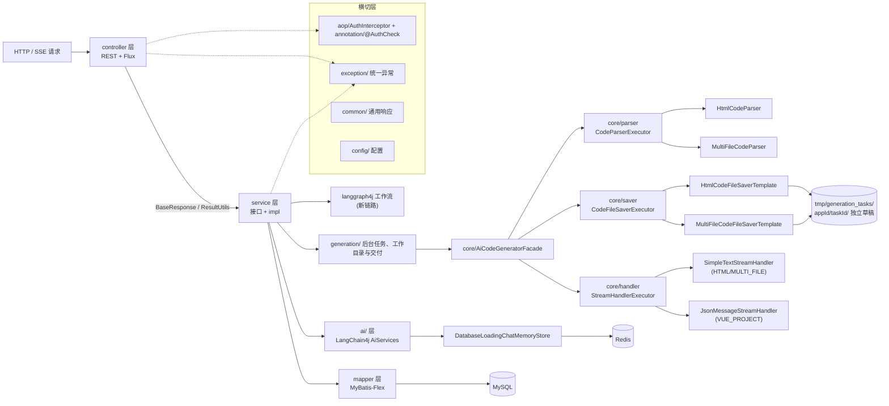
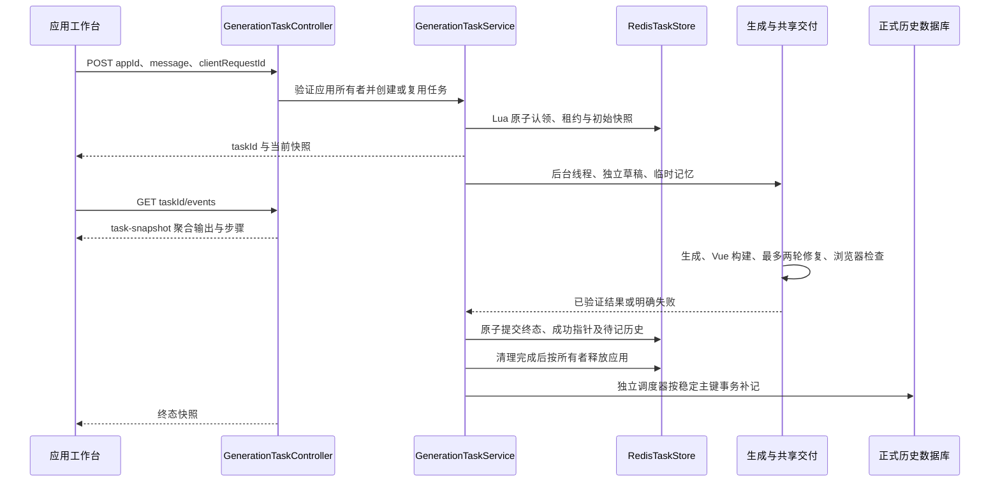
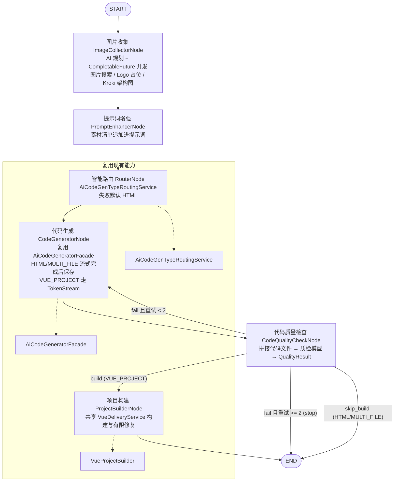
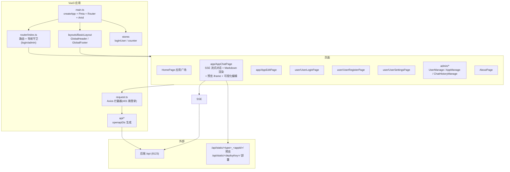

# AI 代码生成平台 —— 项目架构总结

> 基于源码阅读整理。后端 `src/main/java/com/xhl/aicodegenerate/`，前端 `ai-code-frontend/`。

## 1. 项目概览

AI 驱动的代码生成平台：用户注册"应用"（App）并填写提示词，应用固定选择标准模式或工作流模式，系统另行选择代码类型（原生 HTML / 多文件 / Vue 工程），由大模型生成完整前端代码，代码落盘后可**预览**、**部署**、**下载**；对话历史持久化以支持多轮连续生成。

- **后端**：Java 21 · Spring Boot 3.5 · Maven · MyBatis-Flex ORM · LangChain4j（LLM 抽象）· LangGraph4j（图工作流编排）· WebFlux/Reactor（流式 SSE）
- **前端**：Vue 3 · TypeScript · Vite · Ant Design Vue · Pinia · Vue Router
- **存储**：MySQL（`ai_code_generate`：user / app / chat_history）+ Redis（Spring Session、AI 对话记忆缓存、生成任务与成功版本指针）

## 2. 系统总览架构图

```mermaid
flowchart TB
    User([用户浏览器]) --> FE

    subgraph FE["前端 ai-code-frontend (Vue3 + Vite)"]
        Router["Vue Router<br/>导航守卫(login/admin)"]
        Pages["页面<br/>Home/AppChat/AppEdit/User/Admin"]
        Pinia["Pinia Stores<br/>loginUser"]
        Axios["Axios 请求封装 request.ts"]
        SSE["EventSource 消费 SSE<br/>(AppChatPage)"]
        VisualEditor["可视化编辑器 visualEditor.ts<br/>iframe 选中元素生成 prompt"]
        Api["src/api/*<br/>openapi2ts 自动生成"]
    end

    subgraph BE["后端 Spring Boot (端口 8123, context-path /api)"]
        direction TB
        subgraph CTL["Controller 层"]
            AppCtl["AppController /app"]
            UserCtl["UserController /user"]
            ChatCtl["ChatHistoryController /chatHistory"]
            StaticCtl["StaticResourceController /static/**"]
            WorkflowCtl["WorkflowSseController /workflow"]
            TaskCtl["GenerationTaskController /app/generation/tasks"]
        end
        subgraph SVC["Service 层"]
            AppSvc["AppService<br/>chatToGenCode / deployApp"]
            UserSvc["UserService"]
            ChatSvc["ChatHistoryService"]
            DlSvc["ProjectDownloadService<br/>zip 打包"]
        end
        subgraph TASK["后台任务 generation/"]
            TaskSvc["GenerationTaskService<br/>幂等、应用租约、预算、取消、快照"]
            Runner["DefaultGenerationTaskRunner<br/>临时记忆与模式分流"]
            Delivery["VueDeliveryService<br/>构建诊断、有限修复、浏览器检查"]
            Workspace["GenerationWorkspace<br/>独立草稿与成功版本"]
        end
        subgraph GEN["核心生成管线 core/"]
            Facade["AiCodeGeneratorFacade<br/>生成+保存门面(同步/流式)"]
            Parser["CodeParserExecutor<br/>HtmlCodeParser / MultiFileCodeParser"]
            Saver["CodeFileSaverExecutor<br/>Html/MultiFile CodeFileSaverTemplate"]
            Handler["StreamHandlerExecutor<br/>SimpleText/JsonMessage StreamHandler"]
            Builder["VueProjectBuilder<br/>npm install + build"]
        end
        subgraph AI["AI 集成层 ai/ (LangChain4j)"]
            AiSvc["AiCodeGeneratorService<br/>声明式接口+系统提示词"]
            AiFactory["AiCodeGeneratorServiceFactory<br/>AiServices 动态代理工厂"]
            RouterSvc["AiCodeGenTypeRoutingService<br/>智能路由生成类型"]
            Memory["DatabaseLoadingChatMemoryStore<br/>DB 事实源 + Redis 缓存"]
            Tools["ai/tools<br/>FileWrite/Read/Modify/Delete/DirRead"]
        end
        subgraph WF["LangGraph4j 工作流 langgraph4j/"]
            Workflow["CodeGenWorkflow<br/>MessagesStateGraph 主编排"]
            Nodes["Node 节点<br/>ImageCollector/PromptEnhancer/Router/<br/>CodeGenerator/QualityCheck/ProjectBuilder"]
            WfState["WorkflowContext<br/>跨节点状态"]
            WfAi["图片规划/收集/质检 AI 服务<br/>+ 工厂"]
            WfTools["图片工具<br/>ImageSearchTool/PlaceholderLogoTool/<br/>KrokiMermaidDiagramTool"]
        end
        subgraph INFRA["基础设施"]
            Auth["AOP @AuthCheck<br/>AuthInterceptor 鉴权"]
            Exc["GlobalExceptionHandler<br/>BusinessException/ErrorCode"]
            Cfg["config<br/>CORS/JSON/Redis/模型"]
            Mapper["MyBatis-Flex<br/>entity + mapper + xml"]
        end
    end

    subgraph STORE["外部依赖"]
        MySQL[("MySQL<br/>user / app / chat_history")]
        Redis[("Redis<br/>Session(30天) + ChatMemory")]
        LLM["LLM (OpenAI 兼容)<br/>chatModel / streaming / reasoning"]
        ImgSearch["图片搜索服务<br/>(ImageSearchTool)"]
        NodeEnv["Node.js / npm<br/>(Vue 构建)"]
    end

    %% 前端 -> 后端
    Axios --> AppCtl & UserCtl & ChatCtl
    SSE --> TaskCtl
    Pages --> Axios & SSE & VisualEditor
    Api --> Axios
    Router --> Pages

    %% 后端内部
    AppCtl --> AppSvc & TaskSvc
    WorkflowCtl & TaskCtl --> TaskSvc
    TaskSvc --> Runner & Workspace & Redis
    Runner --> Workflow & Facade & Delivery
    Delivery --> Builder
    Workspace --> Redis
    Facade --> AiFactory & Parser & Saver & Handler
    AiFactory --> AiSvc & RouterSvc & Memory & Tools
    Workflow --> Nodes & WfState
    Nodes --> Facade & WfAi & WfTools
    Nodes --> Builder
    AppSvc --> Builder
    AppSvc --> DlSvc & ChatSvc
    AppSvc --> Memory
    StaticCtl --> GEN

    %% 数据访问
    UserSvc & AppSvc & ChatSvc & Memory --> Mapper
    Mapper --> MySQL
    Memory --> Redis
    AiFactory & WfAi --> LLM
    WfTools --> ImgSearch
    Builder --> NodeEnv
```



## 3. 后端分层架构



## 4. 代码生成核心链路（后台任务与快照 SSE）

前端先以稳定 `clientRequestId` 调用 `POST /api/app/generation/tasks`，随后订阅任务事件。Redis 原子认领幂等键、应用租约和任务；同应用有活跃任务时立即拒绝新意图，不排队。应用保存的模式决定标准或工作流执行，页面断线、刷新、离开均不终止后台任务。



默认总预算 20 分钟。显式停止先进入 STOPPING，取消模型流、禁止文件操作、清理构建进程后才释放应用。状态为成功、失败、取消、超时或服务中断；失去租约的执行者不能发布。任务与幂等保留 24 小时，成功版本指针长期保存；待记正式历史直到数据库写入成功才清除。恢复用 current 接口和快照，不重放旧事件，不自动重跑模型。

兼容生成 SSE 和工作流演示接口均经过同一任务服务，必须提供稳定请求 ID；订阅统一使用 `task-snapshot`。旧的逐 chunk 事件格式已由新协议替代，演示页同步适配。

## 5. 工作流模式链路

`DefaultGenerationTaskRunner` 按应用模式驱动 `CodeGenWorkflow.generateForTask`；演示 `WorkflowSseController (/workflow/execute | /execute-flux)` 同样经任务服务与用户限流键，用 `MessagesStateGraph` 编排 6 个节点，`WorkflowContext` 在 `MessagesState` 中流转：



节点观察器在真实执行前后发送 `running/completed/retrying/skipped/failed`。生成阶段只落盘；Vue 在质检结束后进入共享构建／最多两轮定向修复，静态页面显式跳过 npm 构建，仍须通过浏览器检查。质检异常记录跳过原因，重试耗尽、生成失败和构建失败阻断成功状态。

内部增强与重试使用从正式历史初始化的临时记忆，正式历史只记录一次原始用户输入及最终结果。取消会中断等待线程并向真实 TokenStream 传播取消，阻止后续节点与迟到构建。前端以任务成功快照切换预览。新任务、失败和取消期间保留最近成功版本；标准模式展示简要状态，工作流展示具体步骤和重试。

## 6. 前端架构



## 7. 数据存储设计

| 存储 | 用途 | 说明 |
| --- | --- | --- |
| MySQL `user` | 账号、角色（user/admin） | 密码、头像、简介 |
| MySQL `app` | 注册的应用 | `initPrompt`、`generationMode`（创建后固定）、`codeGenType`、`deployKey`（唯一）、`priority`（精选=99）、`userId` |
| MySQL `chat_history` | 对话历史 | `messageType`（user/ai）、`appId`、`userId`，复合索引 `(appId, createTime)` 支持游标分页 |
| Redis | Spring Session（30 天 TTL） | 登录态 |
| Redis | LangChain4j ChatMemory | `DatabaseLoadingChatMemoryStore` 包装：**写先落 DB 再写 Redis**；**读优先 Redis，缺失/不一致时从 DB 恢复**（DB 为事实源） |
| Redis `generation:*` | 任务、幂等、应用租约、成功版本、待记历史 | 任务与幂等 24 小时；成功指针和未补记历史长期保留 |
| 文件系统 `tmp/generation_tasks/<appId>/<taskId>/` | 本轮草稿与发布后的不可变版本 | 成功指针原子切换；预览固定版本，下载和部署均读取成功来源 |
| 文件系统 `tmp/code_output/<type>_<appId>/` | 旧版兼容目录 | 首次新任务可复制旧成功源码 |
| 文件系统 `tmp/code_deploy/<deployKey>/` | 部署产物 | Vue 工程部署 `dist/` 目录 |

## 8. 关键设计要点

1. **双代码生成链路**：标准模式（按 App 代码类型直连 AI 服务）与工作流模式（LangGraph4j 图编排）共用后台任务入口；工作流节点刻意**复用** `AiCodeGeneratorFacade`、`VueProjectBuilder`、`AiCodeGenTypeRoutingService` 等现有组件，而不是重写。
2. **策略/模板模式**：`CodeParserExecutor`、`CodeFileSaverExecutor`、`StreamHandlerExecutor` 都按 `CodeGenTypeEnum` 分派到具体实现；保存器基于模板方法（`CodeFileSaverTemplate`）。
3. **声明式 AI 服务**：`AiCodeGeneratorService` 等接口由 LangChain4j `AiServices` 在运行时生成动态代理，提示词放在 `src/main/resources/prompt/`；`VUE_PROJECT` 模式额外挂载文件读写工具（最多 20 次顺序工具调用），并切换到推理型流式模型。
4. **容错兜底**：结构化输出解析失败 → 走无记忆 raw 文本 + 本地 `CodeParser` 解析；工作流路由失败默认 HTML；质检失败最多重试 2 次；质检服务异常显式标记跳过后放行。
5. **记忆一致性**：ChatMemory 采用"DB 事实源 + Redis 缓存"，`AppChatMemoryId(appId, userId, taskId)` 显式传递本轮上下文；任务使用临时记忆，终态正式历史按稳定主键事务补记并刷新缓存；工具调用产生的运行时消息（ToolExecutionResult 等）不落业务历史表。
6. **鉴权**：后端 `@AuthCheck(mustRole=ADMIN_ROLE)` + AOP 拦截；前端路由守卫双保险；App 归属校验（本人或管理员）在 Service/Controller 层。
7. **可观测/文档**：Knife4j（`/api/doc.html`）；前端 API 客户端由 `yarn openapi2ts` 从 OpenAPI 规范自动生成。

## 9. 目录结构速览

```
ai-code-generate/
├── pom.xml                          # Spring Boot 3.5 / LangChain4j / LangGraph4j / MyBatis-Flex
├── sql/create_table.sql             # user / app / chat_history
├── src/main/java/com/xhl/aicodegenerate/
│   ├── controller/                  # App / User / ChatHistory / Static / Workflow / Health
│   ├── service/ + service/impl/     # 业务逻辑
│   ├── generation/                  # 后台任务、Redis 所有权、版本、Vue 交付与补记历史
│   ├── core/                        # AiCodeGeneratorFacade + parser/ + saver/ + handler/ + builder/
│   ├── ai/                          # LangChain4j 声明式服务 + 工厂 + 记忆存储 + 文件工具
│   ├── langgraph4j/                 # CodeGenWorkflow + node/ + state/ + ai/ + tools/ + model/
│   ├── entity/ mapper/              # MyBatis-Flex 数据访问
│   ├── model/                       # dto/ vo/ enums/
│   ├── annotation/ aop/             # @AuthCheck 鉴权
│   ├── common/ exception/ config/ constant/ utils/
│   └── generator/                   # MyBatis-Flex 代码生成工具(开发期)
├── src/main/resources/
│   ├── prompt/                      # codegen-html / multi-file / vue-project / routing / quality / image
│   └── application.yml / application-local.yml
└── ai-code-frontend/                # Vue3 + TS + Vite + Antd + Pinia
    └── src/
        ├── pages/                   # Home / app/* / user/* / admin/*
        ├── router/ stores/ request.ts
        ├── api/                     # openapi2ts 自动生成
        ├── components/ utils/       # AppChatComposer / visualEditor
        └── config/env.ts            # 预览/部署 URL 构造
```
