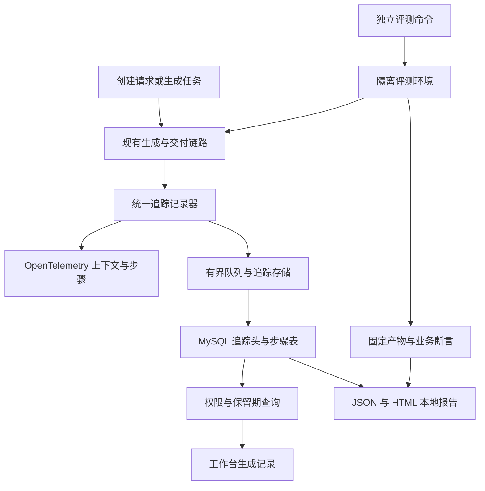

# 方案设计：生成过程追踪与独立质量评测

推荐在现有生成服务中加入统一追踪记录器，使用 OpenTelemetry 表达调用关系，在现有 MySQL 新增两张追踪表支撑工作台查询；评测采用独立 Java 命令入口，复用真实生成、构建和 Selenium 能力，通过固定规格判断结果并导出本地报告。

这样可以分别管理任务执行、过程记录和评测证据。Redis 继续承担当前任务状态与幂等，MySQL 记录七天内的追踪，评测报告不依赖这两类记录永久存在。

| 文档信息 | 内容 |
|---|---|
| Status | `IMPLEMENTED`：2026-11-07 Q11 已批准，随后获授权实现；本地受控范围已实现并核验。证据与外部边界见 [VERIFICATION](VERIFICATION.md)，业务库未迁移 |
| 需求依据 | [PRD.md](PRD.md)，2026-11-07 Q1～Q10 已确认 |
| 设计决定 | D1 已通过：用户在 Q11 批准本文件的 MySQL 两表、兼容查询接口与独立评测入口方案，当时限定只完成文档；后续实施授权见 IMPLEMENTATION_PLAN；取舍见 [ADR-0001](../../decisions/0001-generation-trace-storage.md) |
| 设计时基线 | HEAD `6fcf5d2` 与当时已有未提交修改；最终受测源码／编译摘要见验收 5.4，不把设计时基线作为最终版本 |
| 现状入口 | [架构摘要](../../../architecture-summary.md)、[当前进度](../../PROGRESS.md) |

## 1. 背景与设计目标

### 1.1 设计时核验的现状

| 当前事实 | 源码依据 | 对方案的影响 |
|---|---|---|
| 创建路由早于应用保存和生成 taskId；存在同步主模型／回退模型 | [AppServiceImpl](../../../../src/main/java/com/xhl/aicodegenerate/service/impl/AppServiceImpl.java)、[模型工厂](../../../../src/main/java/com/xhl/aicodegenerate/ai/AiCodeGeneratorServiceFactory.java) | 创建追踪不能要求 appId 或 taskId 已存在，需独立请求编号 |
| 任务由虚拟线程执行，同名阶段被替换；SSE 轮询当前快照 | [GenerationTaskService](../../../../src/main/java/com/xhl/aicodegenerate/generation/GenerationTaskService.java) | 追踪保存独立步骤；不把 SSE 当历史事件存储 |
| 用量包装器绑定任务执行上下文，记录流式完成响应的输入／输出 Token | [UsageTrackingStreamingModel](../../../../src/main/java/com/xhl/aicodegenerate/generation/UsageTrackingStreamingModel.java)、[GenerationExecution](../../../../src/main/java/com/xhl/aicodegenerate/generation/GenerationExecution.java) | 扩展每次调用记录；补同步创建路由；缺失响应不能填零 |
| 图执行、素材任务和流式回调跨线程；结构化任务调用可通过流式模型完成 | [CodeGenWorkflow](../../../../src/main/java/com/xhl/aicodegenerate/langgraph4j/CodeGenWorkflow.java)、[TaskChatModel](../../../../src/main/java/com/xhl/aicodegenerate/generation/TaskChatModel.java) | 显式传递上下文，避免同一调用被多层重复计数 |
| PreviewVerifier 使用 Selenium 检查资源、浏览器错误与挂载 | [PreviewVerifier](../../../../src/main/java/com/xhl/aicodegenerate/generation/PreviewVerifier.java) | 复用浏览器基础设施，新增独立业务断言执行器 |
| 当前工作流 AI 质检输入是源码，不是完整需求；失败时存在跳过策略 | [CodeQualityCheckNode](../../../../src/main/java/com/xhl/aicodegenerate/langgraph4j/node/CodeQualityCheckNode.java) | 把该质检作为被观测步骤，不把其结论当评测事实 |
| 应用／用户为 BIGINT 标识且逻辑删除；应用删除没有清理生成记录的现有机制 | [建表文件](../../../../sql/create_table.sql)、[AppServiceImpl](../../../../src/main/java/com/xhl/aicodegenerate/service/impl/AppServiceImpl.java) | 新追踪需要显式删除协调，不能依赖现有外键级联 |
| 当前全量测试含真实模型调用，没有专用评测 profile | [pom.xml](../../../../pom.xml)、[模型服务测试](../../../../src/test/java/com/xhl/aicodegenerate/ai/AiCodeGeneratorServiceTest.java) | 新建独立执行入口；不能把默认 mvnw test 称为离线评测 |

上述表格保留设计时静态核查，便于理解变更原因；新增追踪、独立评测及运行事实见 [架构摘要](../../../architecture-summary.md) 第 9 节和 [验收记录](VERIFICATION.md)。既有功能的历史验证边界不变。

### 1.2 技术目标

- 对应 REQ-01～03：跨异步边界关联每次真实步骤，提供带权限、保留期和完整性信息的查询，追踪故障不接管生成状态。
- 对应 REQ-04～06：固定样本、配置、初始产物与验收器，按确定性业务断言产出可比较结果，并控制真实模型的调用预算。
- 保持现有 REST／SSE 兼容、两种模式和三种代码类型、任务幂等／取消／成功版本保护。
- 不迁移模型框架，不引入消息队列或新观测云服务，不增加评测发布门禁。

## 2. 技术栈与工程约定

### 2.1 选择与依据

| 位置 | 方案 | 复用／新增与依据 |
|---|---|---|
| 服务端 | Java 21、Spring Boot 3.5.13、现有 MyBatis-Flex | 复用 pom 和分层约定 |
| 模型与编排 | LangChain4j 1.15.0，starter 1.15.0-beta25；LangGraph4j 1.6.0-rc2 | 复用现有模型包装、任务上下文和工作流边界 |
| 追踪 | OpenTelemetry API／SDK **1.49.0** | 新增直接依赖；版本来自 Spring Boot 3.5.13 官方依赖 BOM 的管理值，不自行追最新版本；依赖树已确认 API／context／SDK 均为 1.49.0，编译与运行证据见验收记录 |
| 查询存储 | 现有 MySQL，新增两张追踪表 | D1 设计已批准，已在隔离库建表并验证；业务库未迁移。已有 Redis 的任务状态与 24 小时生命周期不变 |
| 工作台 | Vue 3、TypeScript、Ant Design Vue | 复用现有界面风格、Cookie Session 和 API 错误处理 |
| 评测 | Java 独立入口、Jackson JSON、JUnit 5 回归测试 | 数据集和报告采用可版本化结构；JUnit 验证评测器，命令运行器独立于全量测试 |
| 浏览器 | selenium-java 声明 4.28.1，实际解析／运行组件为 4.31.0 | 复用现有浏览器能力，不同时引入第二套浏览器框架 |
| 报告 | JSON + 静态 HTML + 相对证据路径 | 本地导出；内容转义，不加载远程脚本，不默认公开托管 |

OpenTelemetry 官方依据：[Java 上下文 API](https://github.com/open-telemetry/opentelemetry-java/blob/v1.49.0/context/src/main/java/io/opentelemetry/context/Context.java)、[Spring Boot 3.5.13 依赖 BOM](https://repo.maven.apache.org/maven2/org/springframework/boot/spring-boot-dependencies/3.5.13/spring-boot-dependencies-3.5.13.pom)。2026-11-07 已读取 BOM 并核对管理版本；SDK 的实际依赖解析与集成已通过验证，证据为 `otel-dependencies.log`、`t7-trace-regression.log` 及 `t8-completion-audit.json`（均位于验收记录约定的证据目录）。

首期使用显式业务埋点，不自动采集完整 HTTP 头、请求正文和模型内容；不要求启动 Collector、Jaeger 或 Langfuse。对外 OTLP 导出属于以后可接的适配方向，不列为本次交付。

### 2.2 模块职责

以下模块已按本方案接入；当前事实与源码入口见架构摘要第 9 节。

| 模块 | 职责 | 依赖边界 |
|---|---|---|
| `observability/` | 追踪上下文、步骤记录器、OTel 适配、有限队列与批量写入、清理 | 调用方依赖记录器接口；不反向控制生成状态 |
| 现有 `entity/mapper/service/controller/` | 两张追踪表、只读查询与所有权过滤 | 遵守现有层次，不向前端开放任意 SQL／文件路径 |
| `evaluation/` | 数据集解析、隔离配置、执行、断言、汇总、报告 | 调用现有生成入口与只读产物；不能操作真实用户应用 |
| 仓库 `evaluation/` | 非敏感 JSON 用例、开发／留出清单、初始夹具和验收规格 | 纳入版本控制；实际运行结果进入忽略的 `.evidence/evaluation/` 或指定目录 |
| 工作台追踪组件 | 应用列表、步骤详情、创建诊断 | 通过专用只读 API 查询；不通过管理员可操作权限扩大读取范围 |

本阶段沿用 AGENTS.md 的技术栈规则，不另建规则文件。接口已实现，调用说明维护于 [API.md](../../API.md)，与前端调用入口同步；本方案保留目标契约和选择依据。

## 3. 总体架构与状态传播



图中的评测环境使用独立数据、工作区与配置；报告读取评测所对应的追踪副本，不读取其他用户资料。

### 3.1 记录与传播

1. **创建请求**：服务端生成 requestId；用户认证通过后开始 CREATE 追踪。路由与回退各建立 MODEL 步骤。成功保存应用后绑定 appId；失败保留 owner 和 requestId，不要求虚构 appId。
2. **生成任务**：幂等 claim 成功后建立 GENERATION 追踪；复用原任务的请求直接读取原追踪。独立 root 与 taskId 关联，必要时引用尚可用的创建记录，不把全部历史拼为一个 root。
3. **上下文**：记录器管理明确的 traceId／spanId；OTel Context 随 `GenerationExecution`、虚拟线程、工作流和回调显式捕获／恢复。不能只依赖线程本地变量，也不能把 OTel 的无效全零标识保存为真实编号。
4. **步骤**：开始时入队，结束／失败／取消时更新同一具体步骤；重试总是创建新步骤。步骤号区分时间相同的事件；不逐 Token 写入数据库。初始输出被清空时不删除先前调用的元数据。
5. **结束**：生成状态仍由 GenerationTaskService 决定；实际完成清理和交付后，记录器请求结束追踪。不能由追踪写入器设置任务成功或切换成功产物。
6. **读取**：查询服务检查登录、当前应用归属／是否删除、记录 owner 和过期时间；查询与 Redis 任务 TTL 解耦。只有已确认发生在应用保存之前的创建失败，才能作为“无应用的失败记录”由原发起用户读取；不能只判断 appId 是否为空。

### 3.2 三类状态分别维护

| 状态维度 | 值与含义 | 唯一来源 |
|---|---|---|
| 执行结果 | 运行中、成功、失败、取消、超时、服务中断；缺可靠证据时未知 | 原任务服务；CREATE 由实际创建调用结果给出 |
| 记录完整性 | `COLLECTING` 采集中；`COMPLETE` 已确认写全；`PARTIAL` 已知缺失；无可读记录时响应 `UNAVAILABLE` | 追踪记录器／写入确认；完整性不能反向改变执行结果 |
| 评测结果 | 用例各维度结果、预期结果是否匹配、报告是否完整 | 固定验收器与报告写入器 |

终态提交后迟到的模型用量可补充为已知数据，但不能改写任务结果、复活已清理记录，或仅凭一次迟到回调把整个追踪改为完整。完整性确认需要所有已知步骤闭合且写入确认齐全。

COMPLETE 只表示采集与保存没有已知缺口，不表示供应商返回了全部 Token，也不表示业务断言通过。用量完整性与评测结果继续独立展示。

### 3.3 失败、写入与恢复

记录器通过有界队列写入，不对正常生成调用执行无界等待。单条属性、错误文本和队列容量设置显式上限；超限记录截断／丢失标志。容量与批次作为实施配置给出并验证，不能用无限内存换取表面完整。

每次模型调用的结束采用一次性终结控制，避免完成、异常和取消回调重复累计；迟到用量以同一调用标识做幂等补充。并发任务共享模型客户端时只共享适配能力，不共享当前 trace／task 可变字段；用两个并发任务和交错回调验证不串用。

同一追踪由单一有序写入通道处理，跨追踪可分区；写入先落根记录，再落步骤，最后确认完整终态。根记录初始为 COLLECTING，只有已接受记录全部落盘且没有已知遗漏，才可标 COMPLETE。批量事务失败、队列满、序号缺口或终态写入失败均不能标 COMPLETE；重试使用步骤标识与更新版本幂等，不新增第二次调用。

写入失败的追踪在进程内立即标记缺口；可用时同步至现有任务响应的兼容扩展或追踪查询响应。若数据库完全不可用，则显示“追踪暂不可用”，恢复后只能展示实际保存的部分。初始根记录也丢失时，任务仍可成功，不能承诺一定存在历史追踪条目。

进程恢复后，仅根据现有任务状态／租约和原服务实例存活证据对未闭合记录进行收敛。实施采用独立的 `generation:trace:instance:<实例编号>` Redis 存活记录：每 15 秒由独立线程续约，租约 90 秒，元数据保留 7 天；时间以 Redis 服务端为准。失效后标为 RETIRED，旧采集租约不能复活；它表示采集连续性丢失，不等于业务进程必然退出。恢复跳过本实例、未知实例、有效采集租约以及仍持有原任务租约的记录；可靠终态仅取自匹配任务、应用与用户的原任务快照，否则写 PARTIAL／UNKNOWN，保留缺失时间和用量。Redis 不可用时跳过恢复，不修改任务状态或重放生成。已知旧进程结束且没有可靠任务终态时，标 PARTIAL 与结果未知；不能把另一活跃实例的记录一概改为中断，不能自动重放模型。追踪恢复不是任务断点续跑。

## 4. 详细设计

### 4.1 新增两张追踪表（D1 已批准，已在隔离库验证，业务库未迁移）

不修改现有 app、user、chat_history 的字段或业务数据。新表沿用 MySQL／MyBatis-Flex；BIGINT 对外继续使用字符串。时间统一保存为 UTC，耗时使用单调时钟计算，不能仅用墙上时间相减推断准确耗时。

**`generation_trace`：一次 CREATE 或 GENERATION 的索引与汇总。**

| 字段 | 类型与约束 | 含义 |
|---|---|---|
| trace_id | CHAR(32)，主键，合法非零十六进制 | 本次追踪标识 |
| root_span_id | CHAR(16)，非空 | 根步骤标识 |
| trace_kind | VARCHAR(16)，非空 | CREATE／GENERATION |
| request_id | CHAR(36)，可空，唯一索引 | 创建请求编号；GENERATION 不要求填入 |
| task_id | CHAR(36)，可空，唯一索引 | 生成任务编号；CREATE 为空 |
| user_id | BIGINT，非空 | 已认证的发起用户，不能从请求正文接受 |
| app_id | BIGINT，可空 | CREATE 完成前或失败时可空；生成任务必须关联应用 |
| creation_link_state | VARCHAR(16)，CREATE 默认为 UNRESOLVED | UNRESOLVED：关联待确认／丢失；NO_APP：确定在尝试保存应用前失败；BOUND：已原子保存 app_id 关联；GENERATION 不适用 |
| creation_trace_id | CHAR(32)，可空 | 可得时关联创建追踪；过期后允许目标不可用 |
| generation_mode / code_gen_type | VARCHAR(32)／VARCHAR(32)，可空 | 对应已确定的模式／类型 |
| execution_status / recording_status | VARCHAR(24)／VARCHAR(16)，非空 | 实际执行结果与记录完整性，分别维护 |
| started_at / finished_at / expires_at | DATETIME(3)，仅结束时间可空 | expires_at 为 started_at + 7 天；只读查询主动检查 |
| duration_ms | BIGINT，可空，非负 | 仅记录可可靠获得的耗时 |
| service_instance_id | VARCHAR(64)，非空 | 辨别本次运行所属进程实例 |
| model_calls / input_reported_calls / output_reported_calls | BIGINT，非负，默认 0 | 可观测调用数及分项 Token 上报次数 |
| known_input_tokens / known_output_tokens | BIGINT，可空，非负 | 已知值的汇总；完全未知为 NULL，不据此宣称全量消费 |
| failure_category / safe_message | VARCHAR(64)／VARCHAR(2048)，可空 | 分类错误与有限脱敏说明 |
| artifact_ref / artifact_digest | VARCHAR(512)／CHAR(64)，可空 | 不可变产物相对引用与摘要，不能暴露绝对路径 |
| revision / last_persisted_sequence | BIGINT，非负 | 幂等更新版本和顺序校验 |

业务约束：CREATE 必须有 request_id；GENERATION 必须有 task_id 和 app_id。根记录默认 COLLECTING；不能默认成功或 COMPLETE。索引为 `(user_id, app_id, started_at, trace_id)` 支撑所有者列表，`expires_at` 支撑清理；task_id 与 request_id 的唯一索引用于定位。现有模式、类型校验直接复用枚举。

CREATE 的 app_id 与 BOUND 状态在同一写入事务中更新。只有业务调用明确尚未尝试保存应用而已经失败，才写 NO_APP；数据库保存结果不明、绑定事件丢失或执行仍在进行时保持 UNRESOLVED。此类记录的详情和步骤查询统一拒绝展示，只返回本人可见的“关联未确认／追踪不可用”。生成成功不能仅凭 root 状态写成无应用记录。

**`generation_trace_step`：一次具体阶段／调用／工具操作。**

| 字段 | 类型与约束 | 含义 |
|---|---|---|
| trace_id / span_id | CHAR(32)／CHAR(16)，联合主键 | 归属追踪与具体步骤 |
| parent_span_id | CHAR(16)，可空 | 父步骤；根关联由 trace 表提供 |
| step_no / attempt_no | BIGINT／INT，正数 | 开始顺序与同类重试序号；`(trace_id, step_no)` 唯一 |
| step_kind / step_name | VARCHAR(32)／VARCHAR(128)，非空 | STAGE、MODEL、TOOL、BUILD、PREVIEW、STOP 等稳定名称 |
| status | VARCHAR(24)，非空 | 运行、成功、失败、取消、跳过或未知；不是评测通过率 |
| started_at / finished_at / duration_ms | DATETIME(3)／DATETIME(3)／BIGINT | 结束和耗时可空，缺失不猜补 |
| provider_alias / model_name | VARCHAR(128)／VARCHAR(256)，可空 | 配置别名与实际模型名，不保存密钥或带凭证 URL |
| prompt_version / config_digest | CHAR(64)／CHAR(64)，可空 | 模板集合和脱敏模型配置的 SHA-256 摘要 |
| finish_reason | VARCHAR(64)，可空 | 实际响应返回的结束原因 |
| input_tokens / output_tokens | BIGINT，可空，非负 | 每次调用实际返回的分项用量 |
| safe_metadata | JSON，可空 | 仅白名单属性：工具名、相对路径、构建分类等；大小受限 |
| error_category / safe_message | VARCHAR(64)／VARCHAR(2048)，可空 | 分类与安全诊断；截断须在 metadata 标记 |
| revision | BIGINT，非负 | 防止乱序更新覆盖后来的终态／完整用量 |

不保存逐 Token、原始 Prompt、模型正文、推理正文或完整工具参数。只有最底层实际模型包装器累计调用；上层 TaskChatModel 和图节点仅建阶段记录，避免一调用重复统计。

**迁移与清理：**

- 新增独立幂等迁移 SQL，并同步初始化建表文件；项目没有自动迁移框架，继续由维护者明确执行。旧业务表不回填追踪，旧任务也不伪造历史。
- 新查询服务按应用有效性和 owner 过滤；应用逻辑删除事务提交后立即不可读。在既有删除事务成功提交后触发追踪物理清理，不能因聊天记录删除导致原事务回滚而误清有效应用的追踪；周期任务补偿遗漏与过期记录。锁定顺序保持应用、追踪根、步骤一致，物理删除先步骤后根记录，支持分批重试。
- writer 在同一事务中校验应用仍有效再写入；与应用软删除并发时通过应用行锁协调，删除后的迟到回调不得重新插入记录。迟到绑定事件发现应用已经删除时，按 trace_id 清理此前可能仍为空 appId 的根记录和步骤，不仅按 app_id 删除。
- 无 appId 的 CREATE 按 owner 和保留期清理。若绑定事件完全丢失而无法识别实际应用归属，UNRESOLVED 的详情始终不可读，并最迟按七天保留规则进入清理；不能声称这类记录已按具体应用完成立即物理删除。这是追踪非阻断写入发生故障时的可见性保护与恢复边界。
- 不给现有 app 增加外键。步骤表与根记录的逻辑关联由写入事务与清理器维护，避免应用删除时引入现有表的级联锁定。
- 回退时先禁用新增追踪读写／清理，再回退代码；不默认 DROP 表。已清理记录无法通过代码回滚恢复，恢复需要事先备份；业务 app 和产物不受新表回退影响。
- 部署前核验真实 MySQL 版本、存量数据规模、DDL 权限及索引开销；已在专用隔离 MySQL 8.0.42 验证迁移与事务，尚未迁移业务数据库；生产环境仍需维护者按实际部署核验。

### 4.2 兼容接口与界面

下表记录已批准的接口契约；实现与调用方式见 [追踪 API](../../API.md)，实际验证范围见 [验收记录](VERIFICATION.md)。路径相对现有 `/api`，仍使用 `{code,data,message}` 和现有业务错误码，不改变创建接口 `data` 中的应用 ID 类型。

| 接口 | 输入／输出 | 权限与错误 |
|---|---|---|
| 原 `POST /app/add` 的兼容扩展 | 响应增加服务端生成的 `X-Request-Id`；成功／失败都保留，正文结构不变 | 原登录与创建规则不变；客户端只把编号当关联键，不当凭证 |
| `GET /app/traces?appId=&cursor=&pageSize=` | 应用追踪分页；返回简要结果、完整性、时间、用量覆盖和下一游标 | 服务端验证当前所有者；默认每页 20、最大 20，沿用项目列表限制；过期／删除不返回 |
| `GET /app/traces/{traceId}` | 根记录、完整性、用量汇总、产物引用，不含正文 | 登录且 owner 匹配；关联应用仍有效；无权／过期用现有错误规范 |
| `GET /app/traces/{traceId}/steps?cursor=&pageSize=` | 以 step_no 为游标返回步骤、父关系和有限属性 | 同根记录校验；设计上限每页 100；不得接受客户端任意排序字段 |
| `GET /app/traces/by-task/{taskId}` | 定位任务对应 trace；可在 Redis 快照过期后读取 | 依追踪 owner 和当前应用归属鉴权，不复用要求 Redis 必须存在的查询 |
| `GET /app/traces/by-request/{requestId}` | 定位 CREATE 记录，即使 appId 为空 | 仅发起用户；BOUND 检查应用，NO_APP 允许读取，UNRESOLVED 只返回不可用状态；此检查同样用于 traceId 详情／步骤接口 |

新增字段在 task DTO／SSE 如需提供，只作为可选的 traceId／recordingStatus；原客户端可忽略。appId／userId 等 Long 继续按字符串返回，避免前端精度丢失。创建 requestId 由服务器产生，不采用用户可伪造的值作为所有权依据。

当前 CORS 已配置暴露响应头；实现时仍需真实浏览器验证 Cookie 与 `X-Request-Id` 可读，不通过放宽跨域授权来解决问题。追踪端点不可静态匿名托管。

工作台在现有顶部操作区增加“生成记录”，在当前任务状态区增加“查看本次过程”；沿用 `isOwnApp`，不能使用包含管理员的 `canOperate` 作为追踪权限。正在运行时随现有任务快照触发节流刷新，终态后拉取最终记录；过期后的列表独立读取 MySQL。创建失败提示保留原错误并提供编号与诊断入口。具体布局在实现前按项目的前端设计规范细化，本轮不制作 UI 代码。

### 4.3 模型计数、隐私和隔离

追踪同步路由与任务流式模型；结构化调用经 TaskChatModel 转到流式模型时只在实际模型适配器计一次。业务重试、回退与工具循环导致的新模型调用均独立记录。供应商 SDK 内部重试若不可观测，日常追踪须明确为“模型接口调用数”，不能写成 HTTP 实际请求数。

真实评测关闭或接管 SDK 隐式重试；每次实际出站请求在发起前原子预占调用额度，失败也消耗次数。若某适配器无法证明预算覆盖所有重试，则该适配器不能进入受预算保障的真实评测。取消和超时终止后续调用，尽力取消已发出请求；不能承诺供应商停止计费。

记录采用白名单投影，禁止自动序列化 ChatRequest、ChatResponse、异常对象和工具参数。相对路径经过任务根边界校验，安全错误由类别／阶段与有限白名单诊断组成；简单正则遮盖不视为可靠脱敏。模板与非秘密配置摘要在调用开始时固定，避免运行中配置变化导致错误归因。

### 4.4 24 条数据集与验收规格

建议分为 12 条业务质量用例和 12 条工程故障用例。开发集为 6 条业务 + 12 条工程，共 18 条；留出集为另外 6 条业务。两组分别包含新建和修改，每种模式／代码类型组合均有覆盖。留出集不参与日常 Prompt 调整。

| 编号 | 模式／类型 | 场景与核心断言 | 分组 |
|---|---|---|---|
| B01 | 标准／HTML | 新建计数器，点击后数值增加 | 开发 |
| B02 | 工作流／HTML | 新建任务清单，新增后出现指定条目 | 留出 |
| B03 | 标准／多文件 | 新建订单列表，按状态筛选后仅显示匹配项 | 开发 |
| B04 | 工作流／多文件 | 新建报名表，空值被拒绝、有效提交得到确认 | 留出 |
| B05 | 标准／Vue | 新建任务管理，新增与完成操作改变列表状态 | 开发 |
| B06 | 工作流／Vue | 新建库存列表，关键词筛选显示匹配记录 | 留出 |
| B07 | 标准／HTML | 基于固定计数器新增重置，原增加操作仍有效 | 留出 |
| B08 | 工作流／HTML | 基于固定任务清单新增完成筛选，新增功能仍有效 | 开发 |
| B09 | 标准／多文件 | 基于固定订单列表新增重置筛选，原筛选仍有效 | 留出 |
| B10 | 工作流／多文件 | 基于固定报名表新增邮箱格式校验，原有效提交仍有效 | 开发 |
| B11 | 标准／Vue | 基于固定任务管理新增筛选，新增与完成仍有效 | 留出 |
| B12 | 工作流／Vue | 基于固定库存列表新增缺货筛选，关键词筛选仍有效 | 开发 |
| E01／E02 | 标准／工作流，HTML | 首轮不完整输出后重生成；第一次不能成为成功产物 | 开发，工程 |
| E03／E04 | 标准／工作流，Vue | 构建错误后修复，需求仍保留；初始生成和一次修复分别保留，底层模型调用按实际次数记录 | 开发，工程 |
| E05／E06 | 标准／工作流，多文件 | 模型调用失败且无用量，失败分类明确、未知不填零 | 开发，工程 |
| E07／E08 | 标准／工作流，多文件 | 流式中途取消，终态取消、旧成功版本不被覆盖 | 开发，工程 |
| E09／E10 | 标准／工作流，Vue | 构建超时，进程清理且无本轮成功发布 | 开发，工程 |
| E11／E12 | 标准／工作流，Vue | 追踪写入故障，生成仍可成功，记录完整性明确下降 | 开发，工程 |

这张表对应已实现的 24 条固定用例，数据集入口为 [suite.json](../../../../evaluation/suite.json)，最终两轮运行与摘要核验见验收 5.4。工程用例仅在受控模式运行；真实模式只选择业务用例。每次报告列出完整选择规则、实际入选编号与未选原因，不把 12 条真实业务样本宣称为 24 条真实模型样本。

用例结构：`caseId`、`datasetVersion`、`split`、`category`、`generationMode`、`codeGenType`、`operation`、`prompt`、`fixtureRef`、`fixtureDigest`、`assertionSpecVersion`、`expectedOutcome`、`allowedExecutionModes`。修改用例使用版本固定的初始代码／必要会话，不依赖另一个随机模型刚生成的应用。

新建用例走现有创建路由；codeGenType 表示该用例的预期类型，不能在路由之后偷偷改写应用类型。受控路由夹具返回规定类型；真实模型路由不符合预期时，记录路由不匹配为该用例失败，保留创建追踪，下游不适用步骤明确标记未执行。修改用例从固定类型的初始应用开始。由此区分“没有测到目标类型”与“目标类型生成质量通过”。

断言规格只允许维护者仓库内的白名单动作，如定位可访问名称／稳定标记、点击、输入、读取文本、统计条目、检查可见性；不执行模型提供的任意测试脚本。生成输入中可约定必要的可访问名称，但通过条件由独立文件定义。不能因定位困难在运行中让模型改写验收器。

### 4.5 命令入口、隔离和产物固定

已新增 `scripts/evaluate.sh` 作为 Java 评测入口的薄封装，启动独立 `EvaluationMain`。脚本负责参数传递与调用构建后的 Java 入口，测试框架负责验证这些组件；它不是 `mvn test` 的别名，也不复用会启动外部模型的全量测试入口。使用 Maven `evaluation` profile 将生产类编译至 `target/evaluation/classes`，跳过测试编译及执行；默认受控模式已验证。

**以下为已实现命令；启动依赖及环境变量见验收第 6 节：**

```bash
# 受控回归：默认不调用真实模型或外部业务工具。
./scripts/evaluate.sh --mode fixture --suite development --output .evidence/evaluation

# 真实评测：下面数值仅示例，每次由维护者明确设置。
./scripts/evaluate.sh --mode live --suite development --max-model-calls 30 --deadline-seconds 1200 --output .evidence/evaluation

# 比较两个已有本地运行，不发起生成或付费请求。
./scripts/evaluate.sh compare --baseline <运行目录A> --candidate <运行目录B>
```

真实模式的调用上限和时限必须显式提供正值；任何秘密只从专用环境配置读取，不作为命令行参数、报告字段或代码仓库内容。目标模型与实际参数必须进入脱敏运行清单；工具／图片搜索在受控模式使用固定夹具，不能只替换主模型而留下其他收费调用。

批次总时限与单任务现有时限共同生效，使用更早的截止时间；批次截止后停止新用例与新模型调用，并沿已有取消路径清理当前执行。清理和报告落盘阶段只允许结束资源与保存已得证据，不再发起生成；不能用“正在写报告”延长模型调用预算。

评测配置与生产配置分离：专用数据库／Schema、Redis 命名空间或实例、工作目录、受控账号与应用。启动前验证这些边界，不从 application-local.yml 静默继承生产凭据和应用 ID；未满足隔离则拒绝执行。首期顺序执行用例，避免并发资源竞争影响初始基线；每个用例创建新的隔离应用与任务。

评测复用真实任务服务，保留幂等、取消、构建、修复和成功版本保护语义。受控模式替换模型／外部工具边界，不替换核心生成编排和浏览器判断。npm 依赖安装仍是运行环境的一部分：优先使用固定夹具和锁定依赖；不能把“未调用真实模型”说成完全无网络或无需构建环境。

观察任务终态后，把本次成功产物复制为只读评测快照并计算摘要，浏览器只读取这一快照，不读取随后可能变化的应用 current 指针。失败时保留允许访问的受控诊断与必要草稿证据，不将其登记为成功产物。不会调用真实应用部署入口。

### 4.6 结果、证据与比较

每个运行保存 `run.json`、`cases/<caseId>/result.json`、固定输入／初始产物／输出摘要、必要截图与日志，以及 `report.json`、`report.html`。先写临时文件并原子替换，最后生成完成清单。运行路径使用系统生成的 runId，不能由用例中的文件名越界写入；已存在目录不覆盖。

运行清单记录：schemaVersion、runId、模式、所选用例、数据集／验收器摘要、Git 修订与受测树摘要、模型安全参数、Prompt 模板版本、开始／结束、调用预算、环境版本、浏览器视口与证据摘要。脏工作区不能只记录 HEAD；需提供无秘密的受测源码快照，或明确标为缺少可恢复源码，不能声称完整可复现。

每个用例记录以下独立字段：

- `generationOutcome`：实际生成终态与最终产物摘要。
- `checks`：构建／加载／各业务断言的 PASS、FAIL、ERROR、NOT_APPLICABLE；保存具体失败步骤。
- `verdict`：是否满足该用例预先定义的 expectedOutcome。工程用例期待取消时可 PASS，但 generationOutcome 仍为 CANCELLED。
- `traceCompleteness`、`evidenceCompleteness`、`comparisonEligibility`：分别标记过程缺口、必要证据缺口与可比较性，不由单个布尔“成功”替代。
- `usage`：调用数、分项已知 Token、分项上报次数、覆盖率；完全未知为 NULL，0 只来自真实上报或确定没有调用的事实。

业务通过率以实际入选的业务质量用例为总分母，并列出环境错误、取消、跳过与缺证据数量；构建指标只统计需要构建的用例。工程预期故障通过率单独汇总。完整可比较集合另列编号与数量，缺失样本不被悄悄丢弃。小样本按业务／工程分组展示逐项原始值及耗时、调用数、输入／输出 Token 的有效样本数、最小值、中位数和最大值。耗时仅纳入追踪与证据完整且已判定的样本；调用数与 Token 仅纳入用量完整可比的样本。空集合显示未知；混合场景汇总只描述本次样本，不据此归因性能提升，也不给未经支撑的稳定 P95。

比较先检查用例、数据集、验收器和初始产物一致；明确唯一主要变化项，例如模型或 Prompt。环境差异、源树差异、缺失记录等作为可比性说明；无法严格比较时仍可并列展示，但不输出归因式提升结论。

| 退出码 | 含义 |
|---|---|
| 0 | 报告与所需证据完整，全部入选用例符合各自预期；受控模式不代表真实质量 |
| 1 | 报告完整，但有明确质量／断言失败 |
| 2 | 运行或必要证据／追踪非预期缺失，预算用尽、主动停止或报告未完整落盘；保留已取得结果 |
| 3 | 启动前配置、用例、权限或隔离校验失败；没有发起模型调用 |

E11／E12 预先定义“追踪不完整”为注入故障的预期，并由独立故障夹具验证，因此可判工程用例通过；其缺失追踪仍不能进入完整成本／耗时比较集合。普通业务用例发生同类缺失则按不完整运行处理。

浏览器必需证据写入失败时记录证据错误；HTML 对输入、错误、路径和生成内容全部转义，不直接执行模型产物。所有证据链接使用受控相对路径，不把截图或报告写入公开静态资源目录。

## 5. 关键选择与备选方案

| 选择 | 收益 | 代价与结论 |
|---|---|---|
| **MySQL 追踪表 + 本地评测报告** | 复用现有查询与权限；追踪七天生命周期独立于任务；评测证据长期可单独保存 | 增加两表和清理器；D1 已批准并在隔离环境实现验证，业务库迁移另行执行 |
| 继续只用 Redis 任务快照 | 不增加表 | 快照会覆盖步骤且 24 小时过期；扩充为长期记录会改变任务存储职责，不采用 |
| 仅把 OTel Span 发给追踪平台 | 成熟调用树展示 | 前端权限、七天删除、运行中步骤和导出完整性依赖外部后端；不适合作为本次唯一事实源 |
| 全部记录为本地 JSONL | 开发原型简单 | 多用户分页、并发写入、七天清理和删除一致性需额外自建；适合评测产物，不选作线上查询存储 |
| 同时采用 Playwright 或额外模型评分 | 可增加另一类工具能力 | 当前 Selenium 已有基础，固定业务断言足以验证范围；本期不增加 |

选择业务记录作为查询事实源、OTel 表达追踪关系，涉及长期存储／权限职责。D1 已由用户在 Q11 批准，决策理由与后果记录在仓库既有决策入口的 [ADR-0001](../../decisions/0001-generation-trace-storage.md)；详细契约仍由本方案维护。

## 6. 安全、隐私与运行定位

- **身份**：所有者来自服务端 Session；CREATE 无 appId 时必须同时通过 owner 与 creation_link_state 校验；管理员不能绕过追踪权限。接口不得以 traceId 难猜作为授权。
- **边界**：查询先判断应用是否存在／已删除，再返回内容；过期检查位于查询服务而非只靠清理任务。异步写入不能使已删除数据复活。
- **采集**：白名单元数据；不采集模型推理正文、聊天正文、Cookie、Authorization、完整命令或带秘密 URL。报告样本为非敏感固定内容。
- **容量**：队列满、截断、写入失败、未闭合步骤和清理失败有结构化诊断与计数；不新增未经确认的告警平台或 SLO 数字。
- **本地文件**：评测输出位于维护者控制的目录；报告和截图不经正常网站发布流程自动公开；删除由维护者负责。

## 7. 验证、待决与恢复

### 7.1 决定与核验边界

| 项目 | 状态与影响 | 闭环方式 |
|---|---|---|
| D1：MySQL 两表、兼容查询接口和独立评测入口 | 2026-11-07 Q11 已批准；随后用户另行授权先计划后实现 | 决定见 ADR-0001；实施边界与计划见 IMPLEMENTATION_PLAN |
| OTel 1.49.0 类路径与异步传播 | 已解析、编译并完成记录器／流式回调和真实管线验证 | 覆盖范围和最终审查修复见 VERIFICATION；不把批准等同于全量通过 |
| 当前 MySQL 环境与迁移开销 | MySQL 8.0.42 隔离库已验证幂等迁移、权限及删除竞态；业务库未迁移 | 实际业务库规模与迁移窗口由部署维护者核验 |
| 评测环境隔离和真实预算覆盖 | 独立 CLI、真实两轮受控批次及本地 HTTP/SSE 协议验证已执行 | 本地用例和预算结果见 VERIFICATION；未调用付费供应商 |

设计决定与本地实施核验已完成；业务库迁移、真实供应商质量及部署属于未执行的外部边界。全部适用 AC 的证据见验收矩阵，不重开 Q1～Q10 已冻结的产品决定。

### 7.2 REQ／AC 到验证接缝

| 范围 | 拟验证内容 | 预期证据 |
|---|---|---|
| REQ-01，AC-01～04 | 创建主备路由、图重入、异步上下文、幂等与取消、进程中断 | 受控调用序列、trace/step 树、真实任务终态对应关系 |
| REQ-02，AC-05～08 | 所有者授权、分项用量、存储故障、24 小时后查询 | 两用户 API 回归、未知用量夹具、故障恢复记录、可控时钟结果 |
| REQ-03，AC-09～11 | 秘密标记不泄露、7 天过期、应用删除与迟到写入、导出独立生命周期 | 数据库／API 扫描、并发删除测试、本地导出读取 |
| REQ-04，AC-12～15 | 24 条数据集、默认受控、真实预算、初始产物和环境隔离 | 数据集校验、请求计数、隔离目录与应用检查 |
| REQ-05，AC-16～18 | 无效按钮、环境故障、取消分类、独立评测不影响正常发布 | Selenium 真实交互、故障夹具、现有任务／工作区回归 |
| REQ-06，AC-19～21 | 重复运行、对比有效性、报告落盘失败和退出码 | JSON／HTML 报告、文件故障测试、输出完整性清单 |

已有测试入口包括 GenerationTaskServiceTest、GenerationExecutionTest、UsageTrackingStreamingModelTest、PreviewVerifierTest、VueReliabilityIntegrationTest，以及新增 observability／evaluation 包测试。只选择与修改相关的测试运行，不能以原有历史通过记录代替新增功能证据。

### 7.3 恢复顺序

若新追踪导致资源问题，先关闭记录入口及新查询，保留原任务链路；恢复前检查队列／线程和新表状态。代码回退不删除已写记录，清理器与旧代码并行规则须在发布设计中核对。清理已经删除的数据不能靠代码回退复原。

若出现运行环境或证据错误，停止后续生成并把剩余入选用例标为未执行，保留运行清单与已取得证据；业务质量断言失败继续完成固定数据集。预算耗尽或主动停止也保留原分母。显式再次执行生成新的 runId，既有模型消费不能撤销。报告读取不到证据时标缺失，不伪造截图、Token 或通过率。

需求与设计已确认，后续实施授权和执行步骤见 [实施计划](IMPLEMENTATION_PLAN.md)。本文件保留目标契约与技术取舍；实际完成状态、运行证据和未验证范围分别见 [进度](../../PROGRESS.md) 与 [验收记录](VERIFICATION.md)。
